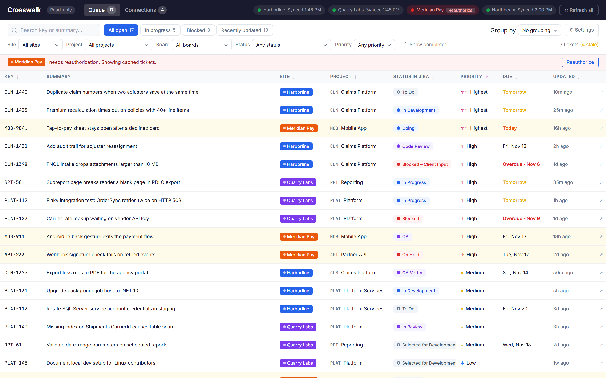
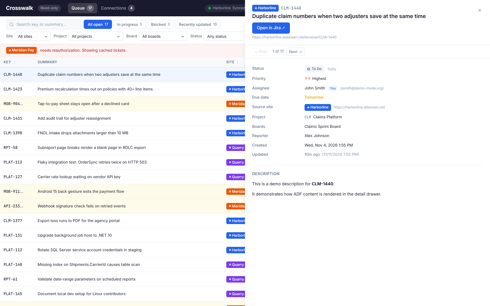
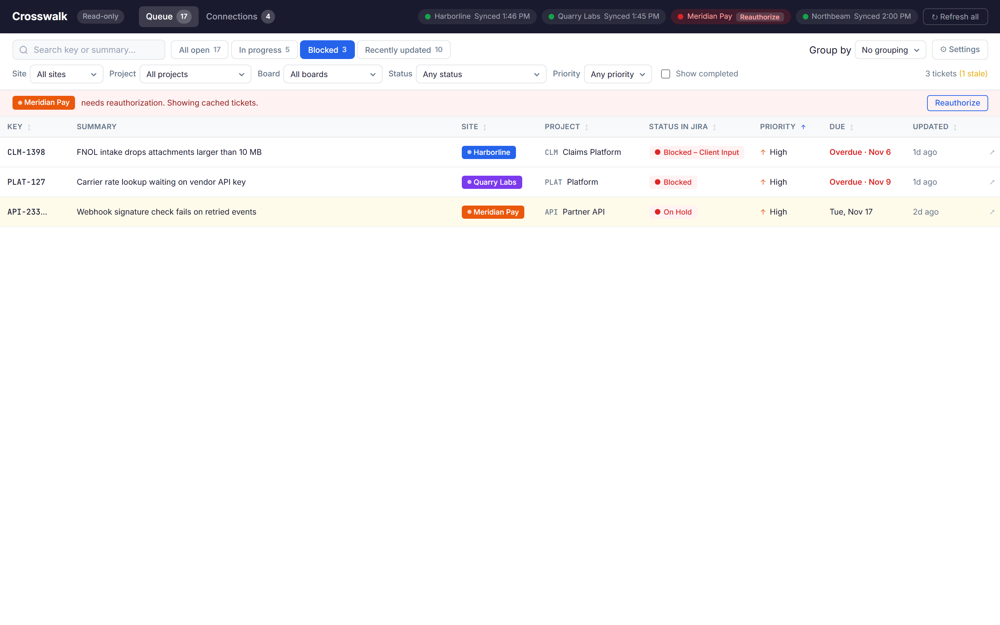
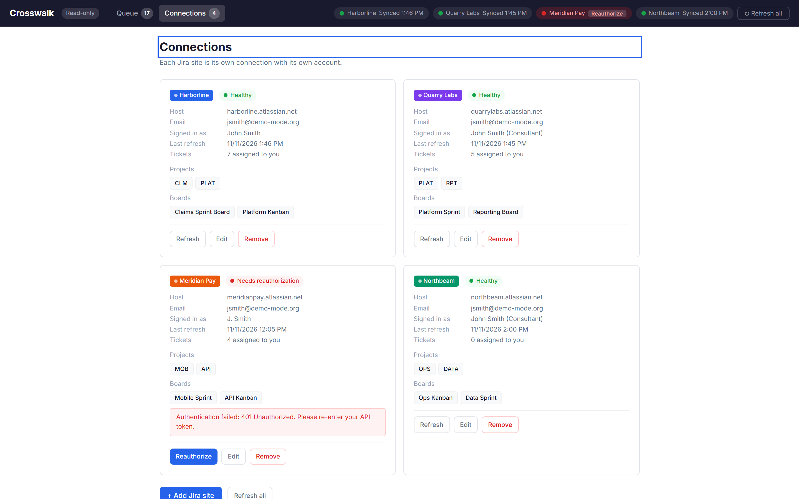
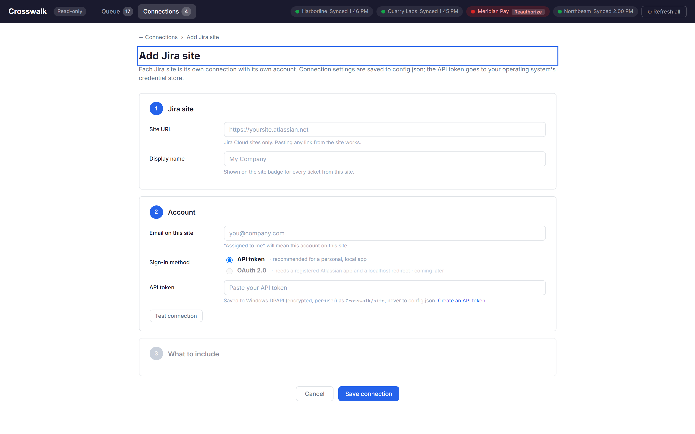
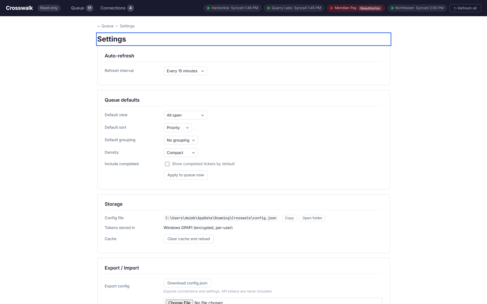

# Crosswalk

**Your assigned Jira tickets across every Jira Cloud site, in one read-only view.**

Crosswalk is a local dashboard that aggregates Jira tickets assigned to you across multiple Jira Cloud sites — each with its own account and email. Open it in the morning, see what needs attention, and click through to act in Jira. It never writes to Jira.

## Screenshots

**Ticket queue** — all your tickets from every Jira site in one table with filters, quick views, and sorting.



**Ticket detail** — click any row to open the detail drawer with status, assignee, description, and a link back to Jira.



**Filtered view** — quick-view buttons (Blocked shown here) instantly narrow the list.



**Connections** — see every connected Jira site, its health, projects, and boards at a glance.



**Add a Jira site** — three-step form: site URL, account credentials, and what to include.



**Settings** — configure refresh interval, queue defaults, and export/import your config.



## Features

- **Multi-site, multi-account** — connect to as many Jira Cloud sites as you need, each with a different email
- **Read-only** — views tickets, never creates, edits, comments on, or transitions them
- **Status normalization** — maps each site's custom statuses to five categories (To do, In progress, In review, Blocked, Done) while always showing the original status name
- **Filtering & sorting** — search, quick views (All open, In progress, Blocked, Recently updated), filter by site/project/board/status/priority, group by site/project/status, sortable columns
- **Detail drawer** — click any ticket for full details including description, with prev/next navigation
- **Stale data handling** — when a site fails to sync, cached tickets are shown with a "Stale" indicator while other sites stay live
- **Secure credential storage** — API tokens are stored in your OS credential store (Windows DPAPI), never in config files or logs
- **Offline-friendly** — cached tickets are available even when Jira is unreachable
- **Demo mode** — run with `--demo` to see the full UI with fixture data, no Jira account needed

## Quick start

### Prerequisites

- [.NET 10 SDK](https://dotnet.microsoft.com/download/dotnet/10.0)
- A Jira Cloud account with an [API token](https://id.atlassian.com/manage-profile/security/api-tokens)

### Run

```bash
cd src/Crosswalk.App
dotnet run
```

This starts the app at `http://127.0.0.1:5391` and opens your browser. Add a Jira site from the Connections page.

### Demo mode

```bash
dotnet run -- --demo
```

Runs with 4 fixture sites and 17 sample tickets — no Jira account required.

### Options

| Flag | Description |
|------|-------------|
| `--demo` | Use fixture data instead of live Jira connections |
| `--port N` | Bind to a different port (default: 5391) |
| `--open` | Force-open the browser (always opens in non-dev mode) |

## Creating a Jira API token

1. Go to [Atlassian API tokens](https://id.atlassian.com/manage-profile/security/api-tokens)
2. Click **Create API token**, give it a label like "Crosswalk"
3. Copy the token — you'll paste it into Crosswalk's Add Jira Site form

Repeat for each Jira Cloud site you use with a different account.

## Where files are stored

| What | Windows | macOS / Linux |
|------|---------|---------------|
| Config | `%APPDATA%\Crosswalk\config.json` | `~/.config/crosswalk/config.json` |
| API tokens | `%APPDATA%\Crosswalk\secrets\` (DPAPI encrypted) | OS keychain or dev fallback |
| Ticket cache | `%APPDATA%\Crosswalk\cache\` | `~/.config/crosswalk/cache/` |

API tokens are **never** stored in `config.json`. Export/import excludes tokens — you'll re-enter them on the new machine.

## Security

- Binds to `127.0.0.1` only — not accessible from other machines
- Origin header validation on API endpoints prevents cross-origin attacks
- API tokens encrypted at rest via Windows DPAPI (per-user scope)
- All Jira API calls use HTTPS with Basic auth (email + API token)
- ADF (ticket descriptions) is converted to safe HTML with entity encoding — no raw HTML passthrough
- `User-Agent: Crosswalk/1.0` on all Jira requests

## Project structure

```
Crosswalk.slnx
src/
  Crosswalk.Core/          # Domain models, Jira client, sync, config, secrets, cache
  Crosswalk.App/           # Blazor Server + minimal API endpoints
tests/
  Crosswalk.Tests/         # Unit + integration tests with recorded HTTP fixtures
```

## License

MIT

---

Crosswalk is an independent project, not affiliated with or endorsed by Atlassian.
